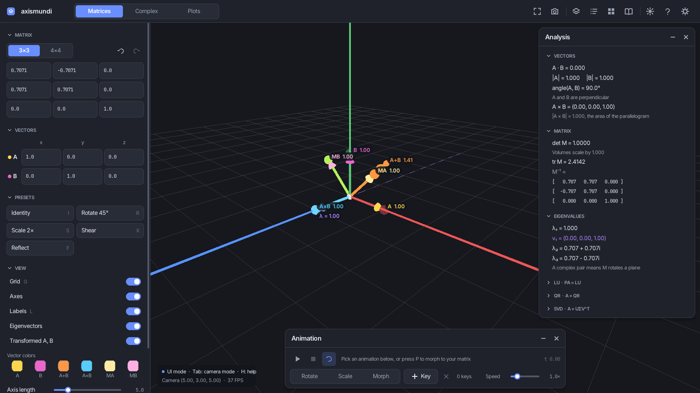
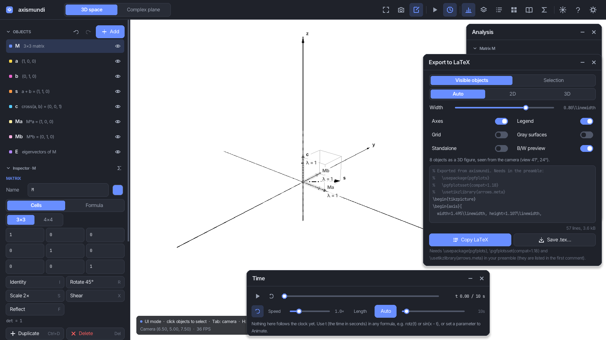
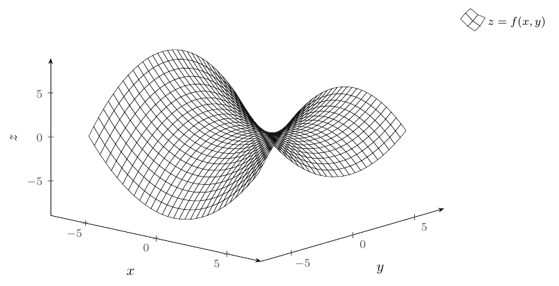
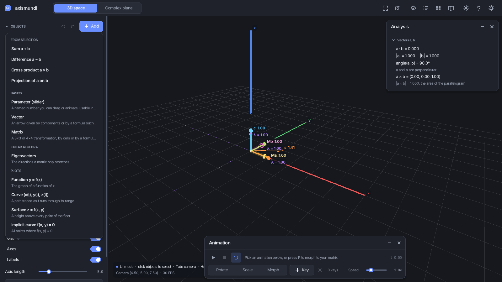
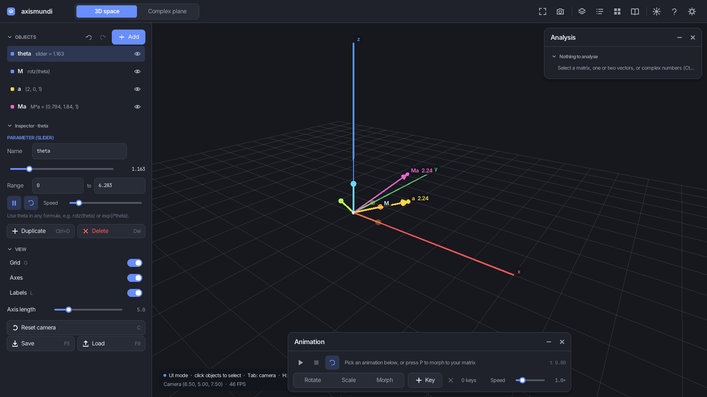
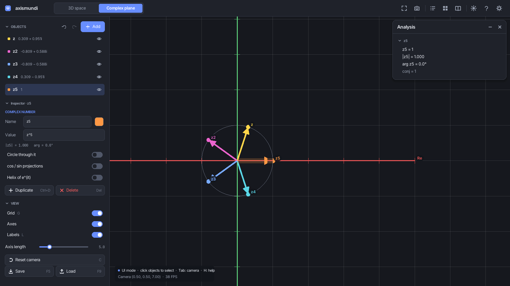
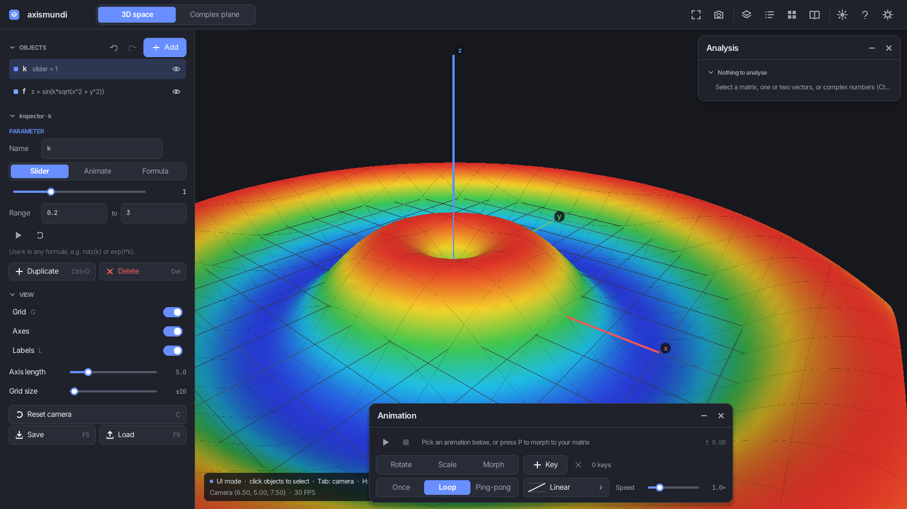
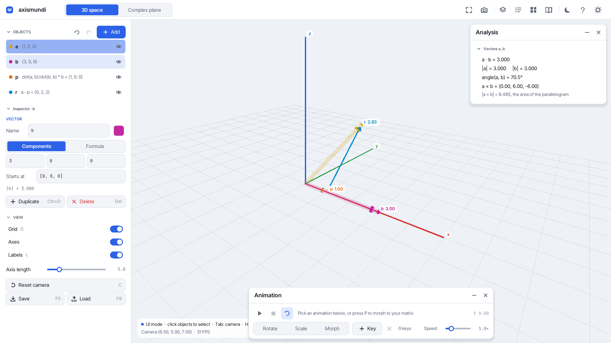
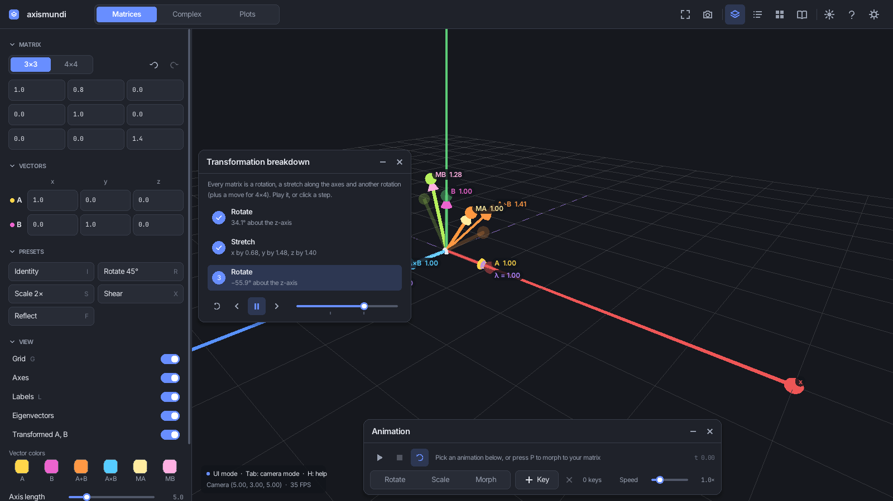
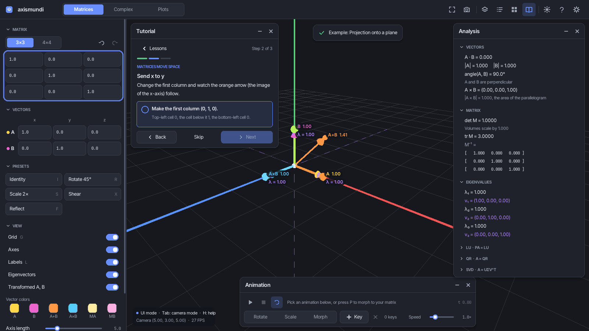

# axismundi: Linear Algebra 3D Visualizer

An interactive 3D tool for exploring linear algebra, complex numbers and functions, with guided lessons
and worked calculations.



## Features

### Objects, formulas and parameters
- Build a scene from **any number of objects**: vectors, matrices, eigenvector sets, plots, parameters and
  complex numbers. Add them with **Add** (or N), select them in the list or by clicking them in the view
  (Ctrl+click for several), edit them in the inspector, hide, duplicate (Ctrl+D) or delete (Del) them.
- **Every field is a formula** that can use other objects by name: `s = a + b`, `c = cross(a, b)`,
  `Ma = M*a`, a matrix cell `cos(theta)`, a whole matrix `rotz(theta)` or `[u, v, w]` (vectors as columns).
  When an input changes, everything that depends on it updates. Circular references and missing names are
  reported on the objects involved.
- **Parameters** are named numbers (θ, k, …) usable in any formula, so they can turn a rotation matrix,
  reshape a surface or move e^(iθ) around the circle. Each one is driven in one of three ways:
  - a **slider**, static, for morphing by hand (e.g. `lerp(eye(3), M, s)`);
  - an **animation** that follows the scene clock from min to max: once, loop or ping-pong, with an easing
    curve (ease in/out, sine, back, elastic, bounce, steps), a duration and a start delay;
  - a **formula of time** `t`, such as `pi/4*cos(2t)`, which may use other objects.
- **`t` is the scene time in every formula**: `[cos(t), sin(t), 1]`, `rotz(t)`, `exp(i*t)`, `sin(x - t)`.
- One **Time panel** plays, pauses and scrubs the scene clock for everything at once.
- The **Add menu** offers templates for the current selection: sum, difference, cross product and projection
  of two vectors, M·v, the eigenvectors, inverse or transpose of a matrix, A·B, z₁·z₂, conjugates…
- Undo/redo covers every change (Ctrl+Z / Ctrl+Y).

### Two spaces
- **3D space** (key 1), with the math convention that z is up and the floor is the xy-plane. It holds:
  - vectors (by components or by formula, with an optional start point);
  - 3×3 / 4×4 matrices (by cells with presets that add up, or by formula) drawn as the moved basis;
  - eigenvector sets;
  - plots: `y = f(x)`, curves `(x(u), y(u), z(u))`, surfaces `z = f(x, y)` and implicit curves
    `f(x, y) = 0`, with heat maps. Detail is set **per unit** (e.g. 30 samples per unit), so a wider range
    stays just as smooth. Surfaces are shaded GPU meshes.
  - Fourier: a function rebuilt from sine waves (partial sums, harmonics, spectrum) and closed curves drawn by
    spinning circles (epicycles) in the complex plane;
  - curves: the moving (Frenet) frame T, N, B with curvature κ, torsion τ, the osculating circle and a curvature
    comb, sliding along with a slider or the clock;
  - derivatives: the tangent line on y = f(x) with the graph of f' and a secant that shrinks into the tangent,
    the tangent plane and gradient of z = f(x, y), and velocity/acceleration along a curve (split into speeding
    up and turning);
  - Taylor polynomials growing term by term (the convergence radius visible for 1/(1 + x²)) and Newton's method
    stepping along tangents to a root;
  - calculus: the volume under z = f(x, y) as Riemann boxes next to the exact double integral (boxes refine as a
    parameter grows), and the work ∫ F·dr of a vector field along a curve, colored where F helps or opposes;
  - quaternions: rotations in four numbers (`qaxis([0, 0, 1], pi/2)`), drawn as their axis and angle with the
    rotated basis and, optionally, a vector before and after; products compose rotations and `slerp` blends
    them (with a gallery set and a tutorial lesson);
  - vector fields `F(x, y, z)` (e.g. `[-y, x, 0]`) on the floor or in a box: arrows scaled and colored by
    strength, flow lines kept evenly apart, and particles that drift along the flow while the clock plays;
    exported to LaTeX as PGFPlots quiver plots.
  - an endless grid that adapts to the zoom (lines every 0.1 … 100), numbers on the axes, optional grid walls and a
    polar grid for the complex plane.
- **Complex plane** (key 2): complex numbers (e.g. `2 + i`, `z1*z2`, `exp(i*theta)`), with optional circle,
  cos/sin projections and the helix of e^(it), and products drawn as a rotation plus a scaling.

### Analysis and learning tools
- **Analysis panel** (M): follows the selection.
  - One vector: its length and unit vector. Two vectors: dot product, angle and cross product.
  - A matrix: determinant, trace, inverse, eigenvalues, LU, QR and SVD.
  - Complex numbers: polar form, product and quotient.
  - Quaternions: the four numbers, axis and angle, the matrix, yaw/pitch/roll; for two, both products and the
    angle between them.
- **Transformation breakdown** (B): the selected matrix as *rotate → stretch → rotate (→ move)*, played step
  by step.
- **Calculation steps** (K): worked calculations with the selected objects' numbers.
- **Tutorial** (F1): 11 lessons with tasks that are checked as you work, including adding objects, formulas
  and parameters.
- **Example gallery** (E): about 20 ready-made scenes.
- **Formula reference** (F2, the Σ button): a searchable cheat sheet of the formula language, every function
  with a live example, and a box to try any formula against your objects.
- **Tooltips** everywhere.

### LaTeX export
- **Export to LaTeX** (Ctrl+E, the export button in the top bar): turns the current space into a
  black-and-white PGFPlots figure that drops into any LaTeX document, like a textbook figure. It uses thin
  lines, line styles instead of colors, math labels (`$\vec a$`, `$z_1$`, `$\theta$`) and your document's
  fonts.
  - Choose the visible objects or only the selection, 2D / 3D / auto, the width (a fraction of
    `\linewidth`), axes, legend, grid, gray surface shading, and a standalone document.
  - **Copy LaTeX** to the clipboard, **Save .tex**, or **Save PDF** (compiled with pdflatex/lualatex when
    installed). The 3D view follows the camera angle.
- **B/W preview**: switches the 3D view to the Paper style (the export's styles) while you design the figure.

| | |
|---|---|
|  |  |

### Interface
- Resolution independent (design reference 1600×900) with a user size setting (Ctrl+= / Ctrl+− / Ctrl+0),
  embedded fonts and real math symbols.
- Dark and light themes (T), floating panels you can drag, collapse and close, fullscreen (F11),
  screenshots (F12).
- View styles (View section): Colorful, Paper (black and white, like the LaTeX export), High contrast (thick
  lines, big labels) and Chalkboard. Selected objects are highlighted and the others fade; labels never overlap;
  **O** shows only the selection.
- Long formulas wrap onto several lines in the inspector; the ⤢ button next to a formula (or Ctrl+Enter while
  typing) opens a big editor that shows the result or the error live. The side bar collapses to a thin strip
  (Ctrl+B or the button left of the logo) to give the view the whole window.
- Preferences in `~/.config/axismundi/settings.txt`. Scenes are saved and opened through a file dialog
  (folders, recent files, Save as); older scene files are converted automatically. The app starts with an
  empty scene; **Demo scene** loads a ready-made one.

| | |
|---|---|
|  |  |
|  |  |
|  |  |
|  |  |

### Formulas

Fields accept:
- numbers and the operators `+ - * / ^`, with implicit multiplication (`2x`, `3(a + b)`);
- vectors `[x, y, z]`, matrices `[[…], […], […]]` (3×3 or 4×4), and `[u, v, w]` to use vectors as columns;
- components `v.x`, the constants `pi`, `e` and `i`;
- functions:
  - `sin cos tan exp log sqrt abs …` (complex-aware);
  - vectors: `dot cross norm normalize`;
  - matrices: `det tr inv transpose rotx roty rotz rot(axis, angle) scale translate eye`;
  - complex numbers: `conj re im arg polar`;
  - quaternions (rotations): `qaxis(axis, angle) quat(w, x, y, z) quat(M) rotate(q, v) mat(q) axis(q) angle(q)
    slerp(a, b, s)`, products `q1*q2`, and `conj inv abs unit q.w`;
  - blending: `lerp(a, b, s)` (any value kind), `keys(s, A, B, …)`, and `mod(a, b)`, `sign(x)`.

`M*v` applies a matrix to a vector (4×4 matrices treat v as a point), and `M*N` composes matrices.
`t` is the scene time (seconds) everywhere; plots use `x` and `y`, and curves use `u` for their own variable.

## Requirements

- C++20 compiler (the Makefile uses `clang++`)
- GNU Make
- **raylib 5.5 or 6.x** with development headers (Arch ships 6.2). The bundled `include/raygui.h` (5.1-dev) uses
  `TextToFloat`, which first appeared in raylib 5.5, so older distribution packages (5.0 and below) will not link.
- Linux

## Installation

### raylib 5.5

If your distribution ships raylib 5.5 or newer, install its development package (Arch: `raylib`,
Debian/Ubuntu: `libraylib-dev`). Otherwise build it from source:

```bash
git clone --depth 1 --branch 5.5 https://github.com/raysan5/raylib.git
cd raylib/src
make PLATFORM=PLATFORM_DESKTOP
sudo make install
```

Building raylib needs the X11 and OpenGL development headers (for example on Alpine:
`mesa-dev libxcursor-dev libxrandr-dev libxinerama-dev libxi-dev`).

### Build

```bash
make build
```

### Install (desktop menu and icon)

```bash
make install            # into ~/.local: the app as `axismundi`, a desktop entry and the icons
make uninstall          # removes them again

make build && sudo make install   # system-wide, into /usr/local (build as yourself first)
```

`axismundi --version` prints the installed version.

### Arch Linux package

`packaging/arch/PKGBUILD` builds an `axismundi-git` package like the AUR's -git packages, from this clone's
`main` branch (committed work only; releases are tagged vX.Y.Z there):

```bash
cd packaging/arch
makepkg -si        # builds, runs the unit tests, installs with pacman (remove with: sudo pacman -R axismundi-git)
```

Remove a `make install` copy first (`make uninstall`), since both provide `axismundi`. To build from a server
instead of this clone, run `_repo=<git url> makepkg -si`.

The build uses `clang++` when it's installed (the compiler the project is tested with) and `g++` otherwise; on
Arch, `sudo pacman -S clang raylib` gives you both dependencies.

After installing, axismundi appears in the GNOME (or other freedesktop) app grid with its icon. The desktop
entry and the icons (a scalable SVG, PNG sizes and a one-color symbolic icon) are in `data/`, named after the
app ID `com.bisonanon.axismundi`; `make icon` redraws them with `tools/icon.py`.

## Usage

```bash
make run                       # build and run
./bin/linalg_viz --theme light # start with the light theme
./bin/linalg_viz --size 1280x720
make test                      # math, expressions, scene, playback and explanation tests (no raylib needed)
```

### Controls

Two cameras, picked in **Settings → Camera**:

- **Orbit** (the default, like Blender): drag the empty view to turn around a center point, right-drag (or
  Shift+drag, or the middle button) to slide the view, the wheel to zoom. A click without dragging selects.
  The **.** key (or **Focus** in the View section) makes the selected object the center; keypad 1 / 3 / 7 (or
  **Front / Right / Top**) look from the front, the right or straight down. In the complex plane a drag pans.
- **Fly** (like a game): **Tab** captures the mouse (camera mode); the mouse looks around, WASD move,
  Space/Ctrl go up and down, Shift moves faster. **Esc** (or Tab) gives the mouse back (UI mode).

Esc never quits: close the window to exit.

| Key | Action |
|-----|--------|
| Drag / right-drag / wheel | Orbit / pan / zoom (orbit camera) |
| . / keypad 1, 3, 7 | Center on the selection / front, right, top view |
| Tab | Camera mode ⟷ UI mode (fly camera) |
| Esc | Leave camera mode, close a popup or the help, cancel an edit |
| 1 / 2 | 3D space / complex plane |
| Click / Ctrl+click | Select an object / add it to the selection |
| O | Show only the selection (again: show everything) |
| N | Add an object |
| Del / Ctrl+D | Delete / duplicate the selection |
| Ctrl+Z / Ctrl+Y | Undo / redo (UI mode) |
| I / R / S / X / F | Presets for the selected matrix, applied on top of it (I starts over; S in UI mode) |
| F1 / E / K / B / M | Tutorial / gallery / calculation steps / breakdown / analysis |
| P | Play / pause the scene clock (Time panel) |
| F2 / Ctrl+E | Formula reference / export to LaTeX |
| Ctrl+Enter / Ctrl+B | Big formula editor (while typing a formula) / hide or show the side bar |
| H | Help with all shortcuts |
| T | Dark / light theme |
| Ctrl+= / Ctrl+− / Ctrl+0 | Bigger / smaller / default UI size |
| F11 / F12 | Fullscreen / screenshot (Shift+F12: 3D view only) |
| C / G / L | Reset camera / grid / labels |
| Ctrl+S or F5 / Ctrl+Shift+S | Save / save as |
| Ctrl+O or F9 | Open a scene file |
| Enter / Tab | Confirm field / next field |

Shortcuts are ignored while a text field is being edited.

## Project Structure

```
.
├── Makefile
├── assets/fonts/             # subset Inter and JetBrains Mono (SIL OFL) + licenses
├── docs/architecture.md      # how the pieces fit together, where to add things
├── docs/learn/               # a guide to the code for C++ beginners (chapters with exercises)
├── docs/screenshots/         # images used by the docs (made with --tour)
├── include/raygui.h          # raygui (single header)
├── tests/                    # unit tests: main.cpp (runner), TestSupport.hpp (CHECK), one file per topic
├── tools/fonts.py            # font subsetting and embedding
├── tools/lesson_walk.py      # temporary tour patch that checks every tutorial step
├── tools/dev/                # build, tour, lesson walk, LaTeX and real-input test scripts
└── src/
    ├── main.cpp              # command-line options
    ├── app/                  # App (loop, input, drawing, files: one class in four files) and Tour
    ├── math/                 # vectors, matrices, decompositions, complex, quaternions, vector fields,
    │   └── expr/             #   derivatives, integrals, curve geometry, Fourier, orbit camera; typed expressions
    ├── scene/                # object model: objects, spaces, dependencies, undo, files
    ├── export/               # LaTeX (PGFPlots) export, black and white; PDF via pdflatex
    ├── text/                 # formula wrapping, label placement
    ├── view/                 # SceneView: draws the objects of a space; view styles
    ├── animation/            # Playback (repeat styles, easing)
    ├── edu/                  # tutorial lessons and gallery examples
    ├── rendering/            # grid, arrows, plots, camera, labels
    ├── ui/                   # side bar (objects + inspector), panels, popovers, widgets
    │   ├── core/             # scaling, fonts, theme, layout, icons, floating panels
    │   └── generated/        # fonts.inc (embedded font data)
    └── include/              # headers, mirroring the folders above
```

`src/math`, `src/scene`, `src/animation`, `src/export` and `src/text` have no raylib dependency, which keeps
them unit-testable. See [docs/architecture.md](docs/architecture.md) for how they fit together, and
[docs/learn/](docs/learn/README.md) for a guided tour of the code written for C++ beginners.

## Development

- `make test` runs the unit tests.
- `make fonts` regenerates `src/ui/generated/fonts.inc` after changing `assets/fonts` (see `tools/fonts.py`).
- `./bin/linalg_viz --tour DIR [--size WxH] [--theme dark|light]` walks through every mode and panel, saves a
  PNG per step into `DIR` and exits. It is used to check the UI at different sizes, also headlessly with
  `xvfb-run`.

- `make gtk` builds `bin/axismundi-gtk`, a GTK4 + libadwaita front end in progress (it needs `gtkmm-4.0` and
  `libadwaita`, on Arch `sudo pacman -S --needed gtkmm-4.0 libadwaita adwaita-icon-theme`). So far it has the 3D
  view, an objects list with an Add menu (types and templates), selection by clicking, an inspector that edits the
  selected object (formulas, modes, sliders, colors, for every object type),
  undo/redo and opening/saving scenes (`bin/axismundi-gtk scene.txt` opens one), the Analysis / Steps / Breakdown
  pane, the scene clock, view settings, the example gallery, LaTeX/PDF export, the formula reference, keyboard
  shortcuts, preferences and the tutorial (the lessons as a card over the view, pointing at the controls). It is
  ready for a first try; the raylib app is still the main one until the parity review. The plan and progress are
  in [docs/gtk-port.md](docs/gtk-port.md).

Open work is listed in [TODO.md](TODO.md) and finished features in [FEATURES.md](FEATURES.md). Helper
scripts for building raylib 5.5, headless screenshot tours, warning checks, tutorial checks and LaTeX compile
checks are in `tools/dev/` (see CLAUDE.md, "Development process").

## License

axismundi — Copyright (C) 2026 Diego Rosalio

This program is free software: you can redistribute it and/or modify it under the terms of the GNU General
Public License as published by the Free Software Foundation, either version 3 of the License, or (at your
option) any later version. It is distributed in the hope that it will be useful, but WITHOUT ANY WARRANTY;
without even the implied warranty of MERCHANTABILITY or FITNESS FOR A PARTICULAR PURPOSE. See [LICENSE](LICENSE)
for the full text (SPDX: `GPL-3.0-or-later`).

Third-party parts keep their own licenses: the embedded fonts Inter and JetBrains Mono are under the SIL Open
Font License 1.1 (`assets/fonts/OFL-*.txt`); raygui (`include/raygui.h`) and raylib are under the zlib license.
