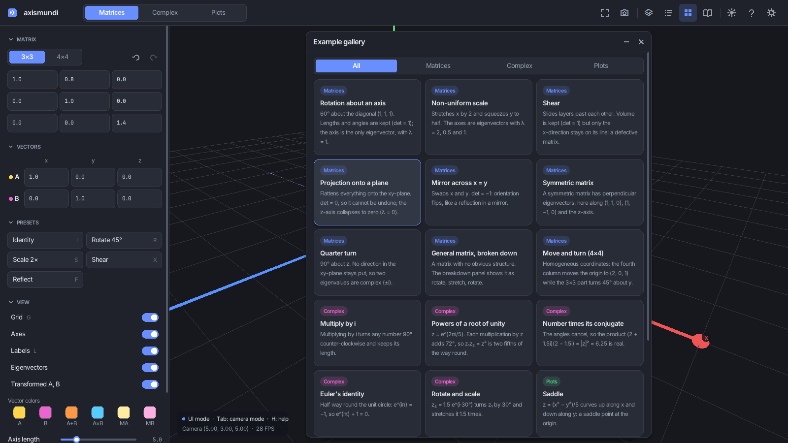
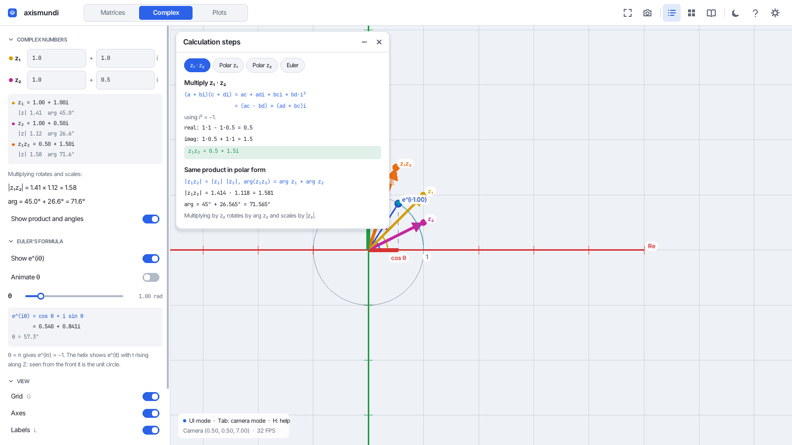

# axismundi: Linear Algebra 3D Visualizer

An interactive 3D tool for exploring linear algebra, complex numbers and functions, with guided lessons
and worked calculations.


## Features

The app has three modes, selected with the tabs in the top bar (or keys **1**, **2**, **3**).

### Matrices
- **3×3 and 4×4 transformations** applied live to the coordinate basis, with undo/redo
- **Editable fields** that accept numbers or expressions (`cos(pi/4)`, `sqrt(2)/2`); invalid input is outlined
  in red and rejected
- **Presets** (identity, 45° rotation, 2× scale, shear, reflection) with keyboard shortcuts
- **Vectors** A, B, A+B, A×B and the transformed vectors MA, MB, labeled with their lengths; colors can be changed
- **Analysis panel**: dot and cross products, angle, determinant (and what it means), trace, inverse,
  eigenvalues and eigenvectors (also drawn in the scene), LU, QR and SVD
- **Animations**: rotation, scaling, morph (identity → your matrix) or your own keyframes, with a timeline
- **Transformation breakdown**: any matrix shown as *rotate → stretch → rotate (→ move)*, played step by step
  with faded copies of the finished steps

### Complex numbers
- Argand diagram with z₁, z₂ and z₁z₂ in rectangular and polar form
- Multiplication shown as a rotation plus a scaling, with the angles adding up
- Euler's formula: e^(iθ) on the unit circle, its cos/sin projections and the helix e^(it)

### Plots
- `y = f(x)`, parametric curves, surfaces `z = f(x, y)` and implicit curves `f(x, y) = 0`
- Heat-map coloring, adjustable ranges and detail, built-in examples

### Learning tools
- **Tutorial** (F1): 9 short lessons. Each step sets up the scene, highlights the control it talks about and gives
  a small task that is checked as you work.
- **Example gallery** (E): 20 ready-made scenes, each with a note on what to look at.
- **Calculation steps** (K): worked, step-by-step calculations for the current inputs, such as the determinant by
  cofactor expansion, the inverse via the adjugate, the characteristic polynomial, or complex multiplication.
- **Tooltips** on controls and results explain what each one means.

### Interface
- **Resolution independent**: the whole UI scales with the window (design reference 1600×900) and has a user
  size setting (Ctrl+= / Ctrl+− / Ctrl+0). Text uses embedded fonts rendered at the exact pixel size, with real
  math symbols (λ, θ, ×, ·, ², ₁).
- **Dark and light themes** (T), dark by default
- **Floating panels** you can drag, collapse and close; their layout is remembered
- **Fullscreen** (F11) and **screenshots** (F12 for the window, Shift+F12 for the 3D view only)
- **Preferences** saved in `~/.config/axismundi/settings.txt`: theme, size, tooltips, panel layout, vector
  colors, finished lessons, window size
- **Scenes** saved and loaded with F5 / F9 (`scene.txt`)

| | |
|---|---|
|  |  |
|  |  |
|  |  |

## Requirements

- C++20 compiler (the Makefile uses `clang++`)
- GNU Make
- **raylib 5.5** with development headers. The bundled `include/raygui.h` (5.1-dev) uses `TextToFloat`, which
  first appeared in raylib 5.5, so older distribution packages (5.0 and below) will not link.
- Linux

## Installation

### raylib 5.5

If your distribution ships raylib 5.5 or newer, install its development package (Arch: `raylib`,
Debian/Ubuntu: `libraylib-dev`). Otherwise build it from source:

```bash
git clone --depth 1 --branch 5.5 https://github.com/raysan5/raylib.git
cd raylib/src
make PLATFORM=PLATFORM_DESKTOP
sudo make install
```

Building raylib needs the X11 and OpenGL development headers (for example on Alpine:
`mesa-dev libxcursor-dev libxrandr-dev libxinerama-dev libxi-dev`).

### Build

```bash
make build
```

## Usage

```bash
make run                       # build and run
./bin/linalg_viz --theme light # start with the light theme
./bin/linalg_viz --size 1280x720
make test                      # math, animation and explanation unit tests (no raylib needed)
```

### Controls

The app has two input states. In **camera mode** (cursor hidden) the mouse looks around, WASD move,
Space/Ctrl go up and down, and Shift moves faster. In **UI mode** (cursor visible) you click fields, buttons
and panels. Press **Tab** to switch; **Esc** always gives the mouse back. Esc never quits: close the window
to exit.

| Key | Action |
|-----|--------|
| Tab | Camera mode ⟷ UI mode |
| Esc | Leave camera mode, close a popup or the help, cancel an edit |
| 1 / 2 / 3 | Matrices / Complex / Plots |
| F1 / E / K / B / M | Tutorial / gallery / calculation steps / breakdown / analysis |
| H | Help with all shortcuts |
| T | Dark / light theme |
| Ctrl+= / Ctrl+− / Ctrl+0 | Bigger / smaller / default UI size |
| F11 / F12 | Fullscreen / screenshot (Shift+F12: 3D view only) |
| C / G / L | Reset camera / grid / labels |
| I / R / S / X / F | Presets (S in UI mode) |
| Ctrl+Z / Ctrl+Y | Undo / redo (UI mode) |
| P | Play / pause animation |
| F5 / F9 | Save / load `scene.txt` |
| Enter / Tab | Confirm field / next field |

Shortcuts are ignored while a text field is being edited.

## Project Structure

```
.
├── Makefile
├── assets/fonts/             # subset Inter and JetBrains Mono (SIL OFL) + licenses
├── docs/screenshots/         # images used by the docs (made with --tour)
├── include/raygui.h          # raygui (single header)
├── tests/test_math.cpp       # unit tests
├── tools/fonts.py            # font subsetting and embedding
└── src/
    ├── main.cpp              # command-line options
    ├── app/                  # App (main loop, shortcuts, save/load, preferences) and Tour
    ├── math/                 # vectors, matrices, decompositions, complex, expressions,
    │                         #   quaternions, breakdown, worked explanations
    ├── animation/            # Animator
    ├── edu/                  # tutorial lessons and gallery examples
    ├── rendering/            # grid, vectors, transforms, Argand, plots, camera, labels
    ├── ui/                   # panels, top bar, side bar, popovers, widgets
    │   ├── core/             # scaling, fonts, theme, layout, icons, floating panels
    │   └── generated/        # fonts.inc (embedded font data)
    └── include/              # headers, mirroring the folders above
```

`src/math` and `src/animation` have no raylib dependency, which keeps them unit-testable.

## Development

- `make test` runs the unit tests.
- `make fonts` regenerates `src/ui/generated/fonts.inc` after changing `assets/fonts` (see `tools/fonts.py`).
- `./bin/linalg_viz --tour DIR [--size WxH] [--theme dark|light]` walks through every mode and panel, saves a
  PNG per step into `DIR` and exits. It is used to check the UI at different sizes, also headlessly with
  `xvfb-run`.

## License

The code is provided as-is for educational purposes. The embedded fonts are under the SIL Open Font License 1.1
(see `assets/fonts/`).
